# Android Development Book Using Java


[TOC]


> [!NOTE]
>
> **Prerequisite**
>
> ### Core Java
>
> - **Programming Language Terminologies**
>   - Data Types, Variables, Literals, Operators, Keywords, Identifiers
> - **Control Statements**
> - **OOP's**
> - **Exception Handling**
> - **Strings**
> - **Arrays**
> - **Collections**

---

### Android Basic Syllabus
1. **Frontend**
   - Adobe XD (UI/UX)
2. **Backend**
   - JAVA
3. **Server and Database**
   - Apache Tomcat & MySQL (XAMPP)
   - GoDaddy Online Server & Database
4. **API**
   - PHP (create and Deploy)
   - Advance Java (Servlets and JSP)

---

### Android Syllabus
1. **Android Introduction**
2. **Basics of Android**
3. **Android UI Widgets**
4. **Activity & Intent**
5. **Menu UI**

---

6. **Layouts, Designing & Animations**
7. **Styles & Templates**

---

8. **Fragments**
9. **Some Advanced Views**
10. **Others** (Gallery, Camera, Call, Messages, Sensors, Flash, etc.)

---

11. **Data Storage**
    - Shared Preference
    - SQLite
12. **SQL Offline and Online Database**
13. **Firebase**

---

14. **API Integration**
    - XML & JSON Parsing
    - Volley & Retrofit API
    - PHP API Creation
15. **Predefined API**
    - Gmail & Facebook Login
    - Google Map API

---

16. **AdMob - Ads**
17. **Google Play Store**

---

18. **Others**
    - Broadcast Receiver
    - Content Provider
    - Services

---

19. **Project**

---


### What is Android
- **Android** is an open source mobile platform which consists of 3 things:
  1. Operating System
  2. Middleware
  3. Android/Key Applications

---

### What is the difference between OS and Platform
- **Platform** = OS + Other Stuff
- **Android Platform** = Android OS (Linux Kernel) + Java Stuff

---

### Architecture Of Android


---

### History Of Android
1. **2003**: Android Incorporation (California) by Andy Rubin and his team
2. **2005**: Google acquired Android company for $50 million
3. **2007**: Google created OHA community
4. **2008**: First Android mobile was launched, HTC
5. **2010**: Google launched Nexus series

---

### Versions of Android
- [Wikipedia](https://en.wikipedia.org/wiki/Android_version_history)
- Latest version: Android 11 - API 30


---

### XML
- **XML** stands for Extensible Markup Language.
- XML is a Markup Language. Other examples of Markup Languages are HTML, DHTML, XHTML, etc.
- XML is also known as a Tag-Based Language.
- **Example:**
  - In HTML we do like this:
  ```html
  <html>
    <head>
      <title> - </title>
    </head>
    <body>
      <input type="text" />
      <Janak>
      </Janak>
    </body>
  </html>
  ```
  - Likewise, in XML:
  ```xml
  <college name="SP Clg" location="Pokhara">
    <branch field="CSE" year="2020">
      <student>
        <name>Janak</name>
        <rollno>101</rollno>
      </student>
      <student>
        <name>Rabin</name>
        <rollno>102</rollno>
      </student>
    </branch>
  </college>
  ```
  Note: Each Tags have its own Attributes
---
### AndroidManifest.xml
- **It contains the details of our Android application:**
  1. How many activities we have created and their names
  2. Which activity should open first
  3. Permissions
  4. App theme, icons
  5. Services
  etc.

**What is an activity?**
- **Activity** simply refers to the XML and Java file combination, meaning the design and the backend part are known as activity.

- `Here is the image to Understand Activity`

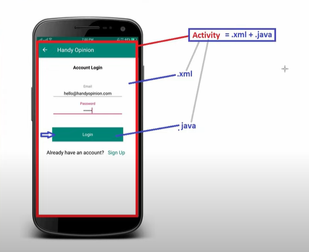
---


### Understanding `Res` folder
- **Drawable**
  - Includes icon images, gradients, shapes, etc.
- **Layout**
  - Includes all layouts of our apps which include widgets
- **Mipmap**
  - Includes launcher icons
- **Values**
  - We can provide all the colors needed for the application
  - We can also provide all the strings here
- **Themes**
  - Themes for our APK

---

### Gradle
- **Gradle** is an open source build system used to automate building, testing, deployment, etc., of our application.
- Gradle is also used to generate the .apk file from .java and .xml files.
- Gradle (build.gradle) contains information about min SDK version, target SDK, Android app versions, etc.

---

### Android SDK
- **SDK** stands for "Software Development Kit."
- As the name suggests, Android SDK is a set of development tools which includes debugger, libraries, documentation, sample codes, tutorials, emulator (AVD), etc.
- Whenever Google releases a new Android version, it also releases a new version of the SDK.

- **Android SDK contains three components:**
  1. SDK Platforms
  2. SDK Tools
  3. SDK Update Sites

---
### Emulator (AVD)
- **Emulator** is a virtual device that acts the same as a physical mobile device.
- Emulator is used to test, debug, and execute our Android application.
- Emulator is a heavy device, so our system configuration should be high to use the emulator.

---

### Understanding Event Listeners

1. **`setOnClickListener`**
   - This method is used to assign an `OnClickListener` to handle click events on a View.

   **Additional Explanation:**
   - When you call `setOnClickListener`, you're essentially saying, "Hey, when someone clicks on this view, do something."

2. **`onClick`**
   - This is an abstract method of the `OnClickListener` interface, which is invoked when the View is clicked.

   **Additional Explanation:**
   - Think of `onClick` as the function that gets executed when the user taps on the associated UI element.

3. **`View view`**
   - `View` is the parent class of UI widgets, and `view` is an object of a particular widget class.

   **Additional Explanation:**
   - In Android, everything visible on the screen is a `View`, and when an event occurs, like a click, the `View` associated with that event is passed to the event handler.

### Understanding `setContentView`

- This method links an XML layout file with the corresponding Java file. It establishes the UI layout for the activity.

   **Additional Explanation:**
   - `setContentView` is crucial because it connects the visual layout defined in XML with the logic written in Java, essentially telling the activity which layout to display.

### Manifest File

- Activities specified in the manifest file with the `intent-filter` tag will be launched first.

   **Additional Explanation:**
   - The `intent-filter` in the manifest file declares what kind of intents the activity can respond to. Activities with intent filters can be launched by external entities, such as other applications or the system.

### Creating Toast Messages

- To display a predefined toast message in a Java file:

```java
Toast.makeText(getApplicationContext(), `text`, Toast.LENGTH_LONG).show();
```

   **Additional Explanation:**
   - Toasts are simple feedback mechanisms used to display brief messages. This method creates a new Toast containing a text message and displays it for a specified duration.

---

## Widgets

### EditText
```xml
<EditText
    android:id="@+id/editText"
    android:layout_width="wrap_content"
    android:layout_height="wrap_content"
    android:hint="Enter text here"/>
```

### RadioButtons
```xml
<RadioGroup
    android:id="@+id/radioGroup"
    android:layout_width="wrap_content"
    android:layout_height="wrap_content"
    android:orientation="vertical">

    <RadioButton
        android:id="@+id/radioButton1"
        android:layout_width="wrap_content"
        android:layout_height="wrap_content"
        android:text="Option 1"/>

    <RadioButton
        android:id="@+id/radioButton2"
        android:layout_width="wrap_content"
        android:layout_height="wrap_content"
        android:text="Option 2"/>
</RadioGroup>
```

### CheckBox
```xml
<CheckBox
    android:id="@+id/checkBox"
    android:layout_width="wrap_content"
    android:layout_height="wrap_content"
    android:text="Check me"/>
```

### Spinner
```xml
<Spinner
    android:id="@+id/spinner"
    android:layout_width="wrap_content"
    android:layout_height="wrap_content"/>
```

### Spinner Drop-down Components

Spinner drop-down components are mentioned in the `values` folder within the `strings.xml` file with attributes of `string-array` like this:

```xml
<string-array name="cities">
    <item>select</item>
    <item>Pokhara</item>
    <item>Ktm</item>
    <item>Npj</item>
</string-array>
```
- Finally we have to use the name of the array in the attributes of the spinner `enteries` and call the name.


---
### Toggle Button

```xml
<ToggleButton
    android:id="@+id/toggleButton"
    android:layout_width="wrap_content"
    android:layout_height="wrap_content"
    android:text="Toggle Button"
    android:textOn="ON"
    android:textOff="OFF"
    android:checked="false"/>
```

### Button

```xml
<Button
    android:id="@+id/button"
    android:layout_width="wrap_content"
    android:layout_height="wrap_content"
    android:text="Button" />
```

#### Usages

```java
Button button = findViewById(R.id.button);
button.setOnClickListener(new View.OnClickListener() {
    @Override
    public void onClick(View v) {
        Toast.makeText(getApplicationContext(), "Button Clicked", Toast.LENGTH_SHORT).show();
    }
});
```

### TextView

```xml
<TextView
    android:id="@+id/textView"
    android:layout_width="wrap_content"
    android:layout_height="wrap_content"
    android:text="TextView" />
```

#### Usages
```
TextView textView = findViewById(R.id.textView);
textView.setText("New Text");
```
### EditText

```xml
<EditText
    android:id="@+id/editText"
    android:layout_width="wrap_content"
    android:layout_height="wrap_content"
    android:hint="Enter text" />
```

#### Usages

```java
EditText editText = findViewById(R.id.editText);
String text = editText.getText().toString();
Toast.makeText(getApplicationContext(), "Entered Text: " + text, Toast.LENGTH_SHORT).show();
```

### Toast

```java
Toast.makeText(getApplicationContext(), "This is a Toast message", Toast.LENGTH_SHORT).show();
```

### Custom Toast

```java
LayoutInflater inflater = getLayoutInflater();
View layout = inflater.inflate(R.layout.custom_toast,
        (ViewGroup) findViewById(R.id.custom_toast_container));

TextView text = layout.findViewById(R.id.text);
text.setText("Custom Toast Message");

Toast toast = new Toast(getApplicationContext());
toast.setDuration(Toast.LENGTH_SHORT);
toast.setView(layout);
toast.show();
```

### CheckBox

```xml
<CheckBox
    android:id="@+id/checkBox"
    android:layout_width="wrap_content"
    android:layout_height="wrap_content"
    android:text="CheckBox" />
```

#### Usages

```java
CheckBox checkBox = findViewById(R.id.checkBox);
checkBox.setOnCheckedChangeListener(new CompoundButton.OnCheckedChangeListener() {
    @Override
    public void onCheckedChanged(CompoundButton buttonView, boolean isChecked) {
        if (isChecked) {
            Toast.makeText(getApplicationContext(), "CheckBox Checked", Toast.LENGTH_SHORT).show();
        } else {
            Toast.makeText(getApplicationContext(), "CheckBox Unchecked", Toast.LENGTH_SHORT).show();
        }
    }
});
```

### RadioGroup and RadioButton

```xml
<RadioGroup
    android:id="@+id/radioGroup"
    android:layout_width="wrap_content"
    android:layout_height="wrap_content">

    <RadioButton
        android:id="@+id/radioButton1"
        android:layout_width="wrap_content"
        android:layout_height="wrap_content"
        android:text="RadioButton 1" />

    <RadioButton
        android:id="@+id/radioButton2"
        android:layout_width="wrap_content"
        android:layout_height="wrap_content"
        android:text="RadioButton 2" />
</RadioGroup>
```

#### Usages

```java
RadioGroup radioGroup = findViewById(R.id.radioGroup);
radioGroup.setOnCheckedChangeListener(new RadioGroup.OnCheckedChangeListener() {
    @Override
    public void onCheckedChanged(RadioGroup group, int checkedId) {
        RadioButton radioButton = findViewById(checkedId);
        Toast.makeText(getApplicationContext(), "Selected Radio Button: " + radioButton.getText(), Toast.LENGTH_SHORT).show();
    }
});
```

### Spinner

```xml
<Spinner
    android:id="@+id/spinner"
    android:layout_width="wrap_content"
    android:layout_height="wrap_content" />
```

#### Usages

```java
Spinner spinner = findViewById(R.id.spinner);
spinner.setOnItemSelectedListener(new AdapterView.OnItemSelectedListener() {
    @Override
    public void onItemSelected(AdapterView<?> parent, View view, int position, long id) {
        String item = parent.getItemAtPosition(position).toString();
        Toast.makeText(getApplicationContext(), "Selected: " + item, Toast.LENGTH_SHORT).show();
    }

    @Override
    public void onNothingSelected(AdapterView<?> parent) {
        // Do nothing
    }
});
```

### ToggleButton and Switch

```xml
<ToggleButton
    android:id="@+id/toggleButton"
    android:layout_width="wrap_content"
    android:layout_height="wrap_content"
    android:textOff="Off"
    android:textOn="On" />

<Switch
    android:id="@+id/switchButton"
    android:layout_width="wrap_content"
    android:layout_height="wrap_content" />
```

#### Usages

```java
ToggleButton toggleButton = findViewById(R.id.toggleButton);
toggleButton.setOnCheckedChangeListener(new CompoundButton.OnCheckedChangeListener() {
    @Override
    public void onCheckedChanged(CompoundButton buttonView, boolean isChecked) {
        if (isChecked) {
            Toast.makeText(getApplicationContext(), "Toggle Button: ON", Toast.LENGTH_SHORT).show();
        } else {
            Toast.makeText(getApplicationContext(), "Toggle Button: OFF", Toast.LENGTH_SHORT).show();
        }
    }
});

Switch switchButton = findViewById(R.id.switchButton);
switchButton.setOnCheckedChangeListener(new CompoundButton.OnCheckedChangeListener() {
    @Override
    public void onCheckedChanged(CompoundButton buttonView, boolean isChecked) {
        if (isChecked) {
            Toast.makeText(getApplicationContext(), "Switch: ON", Toast.LENGTH_SHORT).show();
        } else {
            Toast.makeText(getApplicationContext(), "Switch: OFF", Toast.LENGTH_SHORT).show();
        }
    }
});
```

### ImageView

```xml
<ImageView
    android:id="@+id/imageView"
    android:layout_width="wrap_content"
    android:layout_height="wrap_content"
    android:src="@drawable/ic_launcher_background" />
```

### ImageButton

```xml
<ImageButton
    android:id="@+id/imageButton"
    android:layout_width="wrap_content"
    android:layout_height="wrap_content"
    android:src="@drawable/ic_launcher_background" />
```

### RatingBar

```xml
<RatingBar
    android:id="@+id/ratingBar"
    android:layout_width="wrap_content"
    android:layout_height="wrap_content"
    android:numStars="5"
    android:stepSize="1" />
```

#### Usages

```java
RatingBar ratingBar = findViewById(R.id.ratingBar);
ratingBar.setOnRatingBarChangeListener(new RatingBar.OnRatingBarChangeListener() {
    @Override
    public void onRatingChanged(RatingBar ratingBar, float rating, boolean fromUser) {
        Toast.makeText(getApplicationContext(), "Rating: " + rating, Toast.LENGTH_SHORT).show();
    }
});
```

### DatePicker

```xml
<DatePicker
    android:id="@+id/datePicker"
    android:layout_width="wrap_content"
    android:layout_height="wrap_content"
    android:layout_centerHorizontal="true"
    android:calendarViewShown="true"
    android:datePickerMode="spinner"/>
```

#### Usages

```java
DatePicker datePicker = findViewById(R.id.datePicker);
datePicker.init(2024, 5, 24, new DatePicker.OnDateChangedListener() {
    @Override
    public void onDateChanged(DatePicker view, int year, int monthOfYear, int dayOfMonth) {
        // Handle date change
    }
});

```

### DatePickerDialog

```java
Calendar calendar = Calendar.getInstance();
int year = calendar.get(Calendar.YEAR);
int month = calendar.get(Calendar.MONTH);
int dayOfMonth = calendar.get(Calendar.DAY_OF_MONTH);

DatePickerDialog datePickerDialog = new DatePickerDialog(MainActivity.this,
    new DatePickerDialog.OnDateSetListener() {
        @Override
        public void onDateSet(DatePicker view, int year, int month, int dayOfMonth) {
            // Handle date selection
        }
    }, year, month, dayOfMonth);

datePickerDialog.show();
```

### TimePicker

```xml
<TimePicker
    android:id="@+id/timePicker"
    android:layout_width="wrap_content"
    android:layout_height="wrap_content"
    android:layout_below="@id/textView"
    android:layout_centerHorizontal="true"
    android:timePickerMode="spinner"/>
```

#### Usages

```java
TimePicker timePicker = findViewById(R.id.timePicker);

// Set initial time
timePicker.setHour(12);
timePicker.setMinute(0);

// Optionally set a time change listener
timePicker.setOnTimeChangedListener(new TimePicker.OnTimeChangedListener() {
    @Override
    public void onTimeChanged(TimePicker view, int hourOfDay, int minute) {
        // Handle time change
    }
});

```

### TimePickerDialog

```java
Calendar calendar = Calendar.getInstance();
int hourOfDay = calendar.get(Calendar.HOUR_OF_DAY);
int minute = calendar.get(Calendar.MINUTE);

TimePickerDialog timePickerDialog = new TimePickerDialog(MainActivity.this,
    new TimePickerDialog.OnTimeSetListener() {
        @Override
        public void onTimeSet(TimePicker view, int hourOfDay, int minute) {
            // Handle time selection
        }
    }, hourOfDay, minute, true);

timePickerDialog.show();
```

### AlertDialog

- AlertDialog includes this Things so we have to setthen into our code:

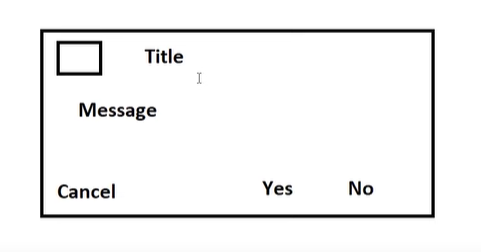
```java
AlertDialog.Builder builder = new AlertDialog.Builder(this);
builder.setTitle("Alert Dialog")
       .setMessage("This is an AlertDialog example.")
       .setPositiveButton("OK", new DialogInterface.OnClickListener() {
           @Override
           public void onClick(DialogInterface dialog, int which) {
               // Handle positive button click
               dialog.dismiss();
           }
       })
       .setNegativeButton("Cancel", new DialogInterface.OnClickListener() {
           @Override
           public void onClick(DialogInterface dialog, int which) {
               // Handle negative button click
               dialog.dismiss();
           }
       })
       .show();
```

### Custom AlertDialog

```java
Dialogue dialogue = new Dialogue(ThisClass.this);
dialogue.setContentView(R.layout.cus_dig);

Button btn = dialogue.findViewById(R.id.button); // Assuming there is a button with id "button" in cus_dig layout

btn.setOnClickListener(new View.OnClickListener() {
    @Override
    public void onClick(View v) {
        // Perform actions when button is clicked
        Toast.makeText(ThisClass.this, "Button Clicked", Toast.LENGTH_SHORT).show();
        dialogue.dismiss(); // Dismiss the dialog
    }
});

dialogue.show(); // Show the dialog
```

### SeekBar

```xml
<SeekBar
    android:id="@+id/seekBar"
    android:layout_width="match_parent"
    android:layout_height="wrap_content" />
```

#### Usages

```java
SeekBar seekBar = findViewById(R.id.seekBar);
seekBar.setOnSeekBarChangeListener(new SeekBar.OnSeekBarChangeListener() {
    @Override
    public void onProgressChanged(SeekBar seekBar, int progress, boolean fromUser) {
        // Handle seek bar progress change
    }

    @Override
    public void onStartTrackingTouch(SeekBar seekBar) {
        // Called when tracking of the seek bar started
    }

    @Override
    public void onStopTrackingTouch(SeekBar seekBar) {
        // Called when tracking of the seek bar stopped
    }
});
```

### ProgressBar

```xml
<ProgressBar
    android:id="@+id/progressBar"
    style="@android:style/Widget.ProgressBar.Horizontal"
    android:layout_width="match_parent"
    android:layout_height="wrap_content"
    android:progress="50" />
```

#### Usages
```java
ProgressBar progressBar = findViewById(R.id.progressBar);

void count(View view) {
    setProgressbarValue(0);
}

void setProgressbarValue(int i) {
    Thread thread = new Thread(new Runnable() {
        @Override
        public void run() {
            try {
                Thread.sleep(1000);
            } catch (Exception e) {
                e.printStackTrace();
            }
            progressBar.setProgress(i); // Changed 'my_progressbar' to 'progressBar'
            setProgressbarValue(i + 1);
        }
    });
    thread.start();
}
```

### ProgressDialog **Circuler**

```java
void showDialogueOfProgress(View view) {
    progressDialog = new ProgressDialog(this);
    progressDialog.setTitle("Progress Dialog");
    progressDialog.setMessage("Loading...");
    progressDialog.setProgressStyle(ProgressDialog.STYLE_SPINNER);
    progressDialog.setCancelable(false); // Optional
    progressDialog.show();

    Button dismissButton = findViewById(R.id.dismissButton); // Assuming you have a button with id dismissButton
    dismissButton.setOnClickListener(new View.OnClickListener() {
        @Override
        public void onClick(View v) {
            progressDialog.dismiss();
        }
    });

    // Start a new thread to simulate a background task
    new Thread(new Runnable() {
        public void run() {
            // Simulate some background task
            try {
                Thread.sleep(5000); // Simulating a task that takes 5 seconds
                progressDialog.dismiss();
                
            } catch (InterruptedException e) {
                e.printStackTrace();
            }
        }
    }).start();
}
```

### ProgressDialog **Horizentical**

```java
public void openProgressDialogTwo(View view) {
    ProgressDialog progressDialog = new ProgressDialog(ProgressDialogDemoTwo.this);
    progressDialog.setTitle("New Title");
    progressDialog.setMessage("Progress......");
    progressDialog.setIcon(R.drawable.home);
    progressDialog.setProgressStyle(ProgressDialog.STYLE_HORIZONTAL);
    progressDialog.setCancelable(false);
    progressDialog.show();

    Handler handler = new Handler() {
        @Override
        public void handleMessage(@NonNull Message msg) {
            super.handleMessage(msg);
            progressDialog.incrementProgressBy(1);
        }
    };

    new Thread(new Runnable() {
        @Override
        public void run() {
            try {
                while (progressDialog.getProgress() <= 100) {
                    Thread.sleep(100); // Use milliseconds, not "mili FBR"
                    handler.sendMessage(handler.obtainMessage());
                }
            } catch (InterruptedException e) {
                e.printStackTrace();
            }
        }
    }).start();
}
```

### ScrollView ***Vertical**

```xml
<?xml version="1.0" encoding="utf-8"?>
<RelativeLayout xmlns:android="http://schemas.android.com/apk/res/android"
    android:layout_width="match_parent"
    android:layout_height="match_parent">

    <!-- Your other layout elements here -->

    <ScrollView
        android:layout_width="match_parent"
        android:layout_height="match_parent">

        <!-- Content to be scrolled -->
        <LinearLayout
            android:layout_width="match_parent"
            android:layout_height="wrap_content"
            android:orientation="vertical">

            <!-- Your content here -->
            <Button
                android:layout_width="wrap_content"
                android:layout_height="wrap_content"
                android:text="Button 1" />

            <Button
                android:layout_width="wrap_content"
                android:layout_height="wrap_content"
                android:text="Button 2" />

            <Button
                android:layout_width="wrap_content"
                android:layout_height="wrap_content"
                android:text="Button 3" />

            <Button
                android:layout_width="wrap_content"
                android:layout_height="wrap_content"
                android:text="Button 4" />

            <Button
                android:layout_width="wrap_content"
                android:layout_height="wrap_content"
                android:text="Button 5" />

            <!-- Add more views as needed -->

        </LinearLayout>
    </ScrollView>

</RelativeLayout>
```

### ScrollView  **Horizentical**

```xml
<?xml version="1.0" encoding="utf-8"?>
<RelativeLayout xmlns:android="http://schemas.android.com/apk/res/android"
    android:layout_width="match_parent"
    android:layout_height="match_parent">

    <!-- Your other layout elements here -->

    <ScrollView
        android:layout_width="match_parent"
        android:layout_height="wrap_content"
        android:scrollbars="none"
        android:layout_alignParentBottom="true">

        <!-- Content to be scrolled -->
        <LinearLayout
            android:layout_width="wrap_content"
            android:layout_height="wrap_content"
            android:orientation="horizontal">

            <!-- Your content here -->
            <Button
                android:layout_width="wrap_content"
                android:layout_height="wrap_content"
                android:text="Button 1" />

            <Button
                android:layout_width="wrap_content"
                android:layout_height="wrap_content"
                android:text="Button 2" />

            <Button
                android:layout_width="wrap_content"
                android:layout_height="wrap_content"
                android:text="Button 3" />

            <Button
                android:layout_width="wrap_content"
                android:layout_height="wrap_content"
                android:text="Button 4" />

            <Button
                android:layout_width="wrap_content"
                android:layout_height="wrap_content"
                android:text="Button 5" />

            <!-- Add more buttons as needed -->

        </LinearLayout>
    </ScrollView>

</RelativeLayout>
```

### ViewFlipper

```xml
<?xml version="1.0" encoding="utf-8"?>
<RelativeLayout xmlns:android="http://schemas.android.com/apk/res/android"
    android:layout_width="match_parent"
    android:layout_height="match_parent">

    <ViewFlipper
        android:id="@+id/viewFlipper"
        android:layout_width="match_parent"
        android:layout_height="wrap_content"
        android:autostart="true"
        android:layout_centerInParent="true">

        <ImageView
            android:layout_width="match_parent"
            android:layout_height="match_parent"
            android:src="@drawable/image1" />

        <ImageView
            android:layout_width="match_parent"
            android:layout_height="match_parent"
            android:src="@drawable/image2" />

        <!-- Add more ImageViews for additional images -->

    </ViewFlipper>

</RelativeLayout>
```

### Usages

```java
    private int[] images = {R.drawable.image1, R.drawable.image2}; // Add more image resource IDs as needed
    private ViewFlipper viewFlipper;

    viewFlipper = findViewById(R.id.viewFlipper);

    // Dynamically add ImageViews with images to the ViewFlipper
    for (int imageId : images) {
    ImageView imageView = new ImageView(this);
    imageView.setImageResource(imageId);
    viewFlipper.addView(imageView);
    }

    // Set flip interval (optional)
    viewFlipper.setFlipInterval(3000); // milliseconds (3 seconds)
    viewFlipper.setAutoStart(true); // Auto start flipping
```

### imageSwitcher

```xml
<?xml version="1.0" encoding="utf-8"?>
<RelativeLayout xmlns:android="http://schemas.android.com/apk/res/android"
    android:layout_width="match_parent"
    android:layout_height="match_parent">

    <ImageSwitcher
        android:id="@+id/imageSwitcher"
        android:layout_width="match_parent"
        android:layout_height="match_parent"
        android:layout_centerInParent="true"
        android:inAnimation="@android:anim/slide_in_left"
        android:outAnimation="@android:anim/slide_out_right" />

</RelativeLayout>
```

### Usages

```java
private int[] imagesId = {R.drawable.image1, R.drawable.image2}; // Add more image resource IDs as needed
private ImageSwitcher imageSwitcher;
private int imgIndex = 0;

imageSwitcher = findViewById(R.id.imageSwitcher);

// Set the ViewFactory for the ImageSwitcher
imageSwitcher.setFactory(new ViewSwitcher.ViewFactory() {
    @Override
    public View makeView() {
        ImageView imageView = new ImageView(getApplicationContext());
        imageView.setScaleType(ImageView.ScaleType.FIT_CENTER);
        return imageView;
    }
});

// Set initial image
imageSwitcher.setImageResource(imagesId[imgIndex]);

public void nextBtn(View view) {
imgIndex = imgIndex + 1;
imageSwitcher.setImageResource(imagesId[imgIndex]);
}

public void previousBtn(View view) {
imgIndex = imgIndex - 1;
imageSwitcher.setImageResource(imagesId[imgIndex]);
}
```

### Adaptor

Adaptor is like a bridge between "Android UI components" and “Data Source". Android UI component can be ListView, GridView, Spinner etc and Data Source can be ArrayList, Set, Map, Cursors, Sqlite etc.

#### Types of Adaptors
1. BaseAdaptor: It is the parent for all the adaptors
2. ArrayAdaptor
3. Custom ArrayAdaptor
4. SimpleAdaptor
5. Custom SimpleAdaptor

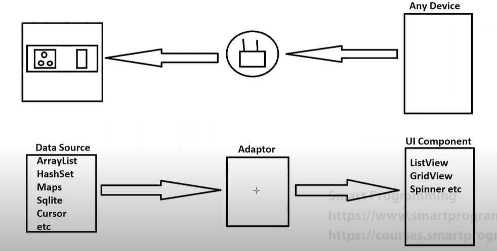

- `Working of the Adapters`

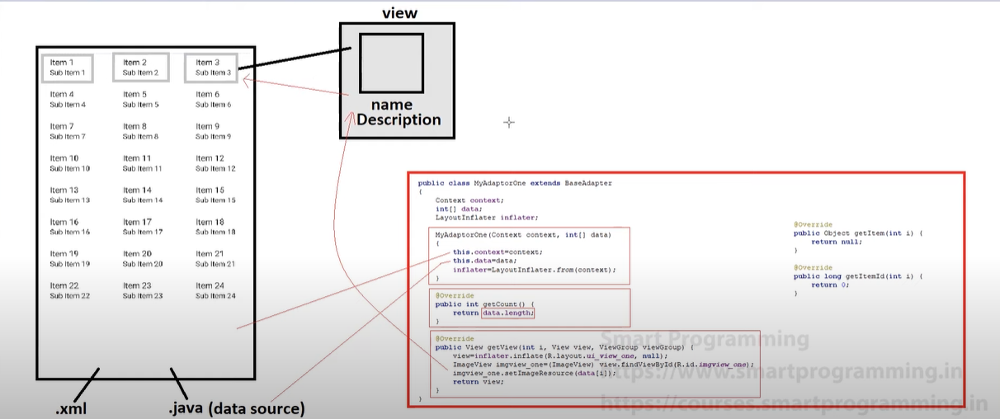

- We can Use adapters for the following ways :-


### 1. GridView with Adapter

**XML Files:**

1. `res/layout/main_activity_two.xml` (Main Activity Layout with GridView)
    ```xml
    <?xml version="1.0" encoding="utf-8"?>
    <RelativeLayout xmlns:android="http://schemas.android.com/apk/res/android"
        android:layout_width="match_parent"
        android:layout_height="match_parent">
    
        <GridView
            android:id="@+id/gridView"
            android:layout_width="match_parent"
            android:layout_height="match_parent"
            android:numColumns="auto_fit"
            android:columnWidth="100dp"
            android:verticalSpacing="10dp"
            android:horizontalSpacing="10dp"
            android:stretchMode="columnWidth"
            android:gravity="center"/>
    </RelativeLayout>
    ```

2. `res/layout/ui_view_two.xml` (Item Layout with ImageView)
    ```xml
    <?xml version="1.0" encoding="utf-8"?>
    <LinearLayout xmlns:android="http://schemas.android.com/apk/res/android"
        android:layout_width="match_parent"
        android:layout_height="wrap_content"
        android:orientation="vertical"
        android:padding="8dp">
    
        <ImageView
            android:id="@+id/imageView"
            android:layout_width="wrap_content"
            android:layout_height="wrap_content"
            android:src="@drawable/ic_launcher_foreground" />
    </LinearLayout>
    ```

**Java Files:**

1. `MainActivityTwo.java`
    ```java
    package com.example.gridviewexample;
    
    import android.os.Bundle;
    import android.widget.GridView;
    import androidx.appcompat.app.AppCompatActivity;
    
    public class MainActivityTwo extends AppCompatActivity {
    
        private int[] dataSource = {
            R.drawable.image1, R.drawable.image2, R.drawable.image3,
            R.drawable.image4, R.drawable.image5, R.drawable.image6,
            R.drawable.image7, R.drawable.image8, R.drawable.image9, R.drawable.image10
        };
    
        @Override
        protected void onCreate(Bundle savedInstanceState) {
            super.onCreate(savedInstanceState);
            setContentView(R.layout.main_activity_two);
    
            GridView gridView = findViewById(R.id.gridView);
            MyAdapterTwo adapter = new MyAdapterTwo(this, dataSource);
            gridView.setAdapter(adapter);
        }
    }
    ```

2. `MyAdapterTwo.java`
    ```java
    package com.example.gridviewexample;
    
    import android.content.Context;
    import android.view.LayoutInflater;
    import android.view.View;
    import android.view.ViewGroup;
    import android.widget.BaseAdapter;
    import android.widget.ImageView;
    
    public class MyAdapterTwo extends BaseAdapter {
        private Context context;
        private int[] dataSource;
        private LayoutInflater inflater;
    
        public MyAdapterTwo(Context context, int[] dataSource) {
            this.context = context;
            this.dataSource = dataSource;
            this.inflater = LayoutInflater.from(context);
        }
    
        @Override
        public int getCount() {
            return dataSource.length;
        }
    
        @Override
        public Object getItem(int position) {
            return dataSource[position];
        }
    
        @Override
        public long getItemId(int position) {
            return position;
        }
    
        @Override
        public View getView(int position, View convertView, ViewGroup parent) {
            if (convertView == null) {
                convertView = inflater.inflate(R.layout.ui_view_two, parent, false);
            }
    
            ImageView imageView = convertView.findViewById(R.id.imageView);
            imageView.setImageResource(dataSource[position]);
    
            return convertView;
        }
    }
    ```

### 2. ListView with Adapter

**XML Files:**

1. `res/layout/main_activity_two.xml` (Main Activity Layout with ListView)
    ```xml
    <?xml version="1.0" encoding="utf-8"?>
    <RelativeLayout xmlns:android="http://schemas.android.com/apk/res/android"
        android:layout_width="match_parent"
        android:layout_height="match_parent">
    
        <ListView
            android:id="@+id/listView"
            android:layout_width="match_parent"
            android:layout_height="match_parent"/>
    </RelativeLayout>
    ```

2. `res/layout/ui_view_two.xml` (Item Layout with ImageView)
    ```xml
    <?xml version="1.0" encoding="utf-8"?>
    <LinearLayout xmlns:android="http://schemas.android.com/apk/res/android"
        android:layout_width="match_parent"
        android:layout_height="wrap_content"
        android:orientation="horizontal"
        android:padding="8dp">
    
        <ImageView
            android:id="@+id/imageView"
            android:layout_width="wrap_content"
            android:layout_height="wrap_content"
            android:src="@drawable/ic_launcher_foreground" />
    </LinearLayout>
    ```

**Java Files:**

1. `MainActivityTwo.java`
    ```java
    package com.example.listviewexample;
    
    import android.os.Bundle;
    import android.widget.ListView;
    import androidx.appcompat.app.AppCompatActivity;
    
    public class MainActivityTwo extends AppCompatActivity {
    
        private int[] dataSource = {
            R.drawable.image1, R.drawable.image2, R.drawable.image3,
            R.drawable.image4, R.drawable.image5, R.drawable.image6,
            R.drawable.image7, R.drawable.image8, R.drawable.image9, R.drawable.image10
        };
    
        @Override
        protected void onCreate(Bundle savedInstanceState) {
            super.onCreate(savedInstanceState);
            setContentView(R.layout.main_activity_two);
    
            ListView listView = findViewById(R.id.listView);
            MyAdapterTwo adapter = new MyAdapterTwo(this, dataSource);
            listView.setAdapter(adapter);
        }
    }
    ```

2. `MyAdapterTwo.java`
    ```java
    package com.example.listviewexample;
    
    import android.content.Context;
    import android.view.LayoutInflater;
    import android.view.View;
    import android.view.ViewGroup;
    import android.widget.BaseAdapter;
    import android.widget.ImageView;
    
    public class MyAdapterTwo extends BaseAdapter {
        private Context context;
        private int[] dataSource;
        private LayoutInflater inflater;
    
        public MyAdapterTwo(Context context, int[] dataSource) {
            this.context = context;
            this.dataSource = dataSource;
            this.inflater = LayoutInflater.from(context);
        }
    
        @Override
        public int getCount() {
            return dataSource.length;
        }
    
        @Override
        public Object getItem(int position) {
            return dataSource[position];
        }
    
        @Override
        public long getItemId(int position) {
            return position;
        }
    
        @Override
        public View getView(int position, View convertView, ViewGroup parent) {
            if (convertView == null) {
                convertView = inflater.inflate(R.layout.ui_view_two, parent, false);
            }
    
            ImageView imageView = convertView.findViewById(R.id.imageView);
            imageView.setImageResource(dataSource[position]);
    
            return convertView;
        }
    }
    ```

### 3. Spinner with Adapter

**XML Files:**

1. `res/layout/main_activity_two.xml` (Main Activity Layout with Spinner)
    ```xml
    <?xml version="1.0" encoding="utf-8"?>
    <RelativeLayout xmlns:android="http://schemas.android.com/apk/res/android"
        android:layout_width="match_parent"
        android:layout_height="match_parent">
    
        <Spinner
            android:id="@+id/spinner"
            android:layout_width="wrap_content"
            android:layout_height="wrap_content"
            android:layout_centerInParent="true"/>
    </RelativeLayout>
    ```

2. `res/layout/ui_view_two.xml` (Item Layout with ImageView)
    ```xml
    <?xml version="1.0" encoding="utf-8"?>
    <TextView xmlns:android="http://schemas.android.com/apk/res/android"
        android:id="@+id/textView"
        android:layout_width="wrap_content"
        android:layout_height="wrap_content"
        android:padding="8dp"
        android:textSize="16sp" />
    ```

**Java Files:**

1. `MainActivityTwo.java`
    ```java
    package com.example.spinnerexample;
    
    import android.os.Bundle;
    import android.widget.Spinner;
    import androidx.appcompat.app.AppCompatActivity;
    
    public class MainActivityTwo extends AppCompatActivity {
    
        private String[] dataSource = {
            "Option 1", "Option 2", "Option 3", "Option 4", "Option 5",
            "Option 6", "Option 7", "Option 8", "Option 9", "Option 10"
        };
    
        @Override
        protected void onCreate(Bundle savedInstanceState) {
            super.onCreate(savedInstanceState);
            setContentView(R.layout.main_activity_two);
    
            Spinner spinner = findViewById(R.id.spinner);
            MyAdapterTwo adapter = new MyAdapterTwo(this, dataSource);
            spinner.setAdapter(adapter);
        }
    }
    ```

2. `MyAdapterTwo.java`
    ```java
    package com.example.spinnerexample;
    
    import android.content.Context;
    import android.view.LayoutInflater;
    import android.view.View;
    import android.view.ViewGroup;
    import android.widget.BaseAdapter;
    import android.widget.TextView;
    
    public class MyAdapterTwo extends BaseAdapter {
        private context;
    
        private String[] dataSource;
        private LayoutInflater inflater;
    
        public MyAdapterTwo(Context context, String[] dataSource) {
            this.context = context;
            this.dataSource = dataSource;
            this.inflater = LayoutInflater.from(context);
        }
    
        @Override
        public int getCount() {
            return dataSource.length;
        }
    
        @Override
        public Object getItem(int position) {
            return dataSource[position];
        }
    
        @Override
        public long getItemId(int position) {
            return position;
        }
    
        @Override
        public View getView(int position, View convertView, ViewGroup parent) {
            if (convertView == null) {
                convertView = inflater.inflate(R.layout.ui_view_two, parent, false);
            }
    
            TextView textView = convertView.findViewById(R.id.textView);
            textView.setText(dataSource[position]);
    
            return convertView;
        }
    
        @Override
        public View getDropDownView(int position, View convertView, ViewGroup parent) {
            if (convertView == null) {
                convertView = inflater.inflate(R.layout.ui_view_two, parent, false);
            }
    
            TextView textView = convertView.findViewById(R.id.textView);
            textView.setText(dataSource[position]);
    
            return convertView;
        }
    }
    ```

### Explanations:

### XML Layout Files
1. **main_activity_two.xml**
   - Create a `ListView`.

2. **ui_view_two.xml**
   - Create an `ImageView`.

### Java Files
1. **MainActivityTwo.java**
   - Create a data source (e.g., an array or list of image resources).
   - Get the ID of the `ListView`.
   - Create an instance of `MyAdapterTwo`, passing the application context and data source.
   - Set the adapter instance to the `ListView`.

2. **MyAdapterTwo.java**
   - Extend `BaseAdapter`.
   - Declare instance variables for context, data, and layout inflater.
   - Implement the constructor to initialize these variables and obtain a layout inflater.
   - Override `getCount()` to return the length of the data.
   - Override `getView()`:
     - Inflate the layout `R.layout.ui_view_two`.
     - Get the ID of the `ImageView`.
     - Set the image resource for the `ImageView` using the data.
     - Return the view.

**Note**: For implementating adapters we need Two xml file one which holds design of the widgets lets say `ImageView` and anouther xml will holds the any one of this view(    - GridView (using Adaptors, ListView (using Adaptors), Spinner (using Adaptors)) and we have 2 java file main file will holds the dataSource and anouther will be the adapter java file.

### SearchView

```xml
<SearchView
    android:id="@+id/searchView" <!-- Unique ID for the SearchView -->
    android:layout_width="match_parent" <!-- Width of the SearchView matches the parent width -->
    android:layout_height="wrap_content" <!-- Height of the SearchView wraps its content -->
    android:queryHint="Search here" <!-- Hint text displayed in the SearchView when it is empty -->
    android:iconifiedByDefault="true" <!-- Whether the SearchView is iconified by default -->
    android:submitButtonEnabled="false" <!-- Whether the submit button is enabled in the SearchView -->
    android:inputType="text" <!-- Type of input expected in the SearchView --> />
```

### Usages

```java

// Method to initialize widgets and set listeners
private void initializeWidgets() {
    // Initialize the SearchView
    searchView = findViewById(R.id.searchView);

    // Set up query text listener
    searchView.setOnQueryTextListener(new SearchView.OnQueryTextListener() {
        @Override
        public boolean onQueryTextSubmit(String query) {
            // Handle the query submission
            // Perform search operation here
            return false;
        }

        @Override
        public boolean onQueryTextChange(String newText) {
            adapter.getFilter().filter(newText)
            return false;
        }
    });

    // Optional: Handle focus change
    searchView.setOnQueryTextFocusChangeListener((v, hasFocus) -> {
        // Handle focus change
    });
}
```

### WebView

```xml
<WebView
    android:id="@+id/webView" <!-- Unique ID for the WebView -->
    android:layout_width="match_parent" <!-- Width of the WebView matches the parent width -->
    android:layout_height="match_parent" <!-- Height of the WebView matches the parent height -->
    android:layout_gravity="center" <!-- Gravity of the WebView within its container -->
    android:scrollbars="vertical" <!-- Whether to display vertical scrollbars -->
    android:scrollbarStyle="insideOverlay" <!-- Style of the scrollbars -->
    android:scrollbarThumbVertical="@android:color/darker_gray" <!-- Color of the vertical scrollbar thumb -->
    android:scrollbarTrackVertical="@android:color/transparent" <!-- Color of the vertical scrollbar track --> />
```

### Usages

```java
import android.app.ProgressDialog;
import android.webkit.WebSettings;
import android.webkit.WebView;
import android.webkit.WebViewClient;
import android.widget.Toast;
import androidx.appcompat.app.AppCompatActivity;
import android.os.Bundle;

public class MainActivity extends AppCompatActivity {

    private WebView webView;

    @Override
    protected void onCreate(Bundle savedInstanceState) {
        super.onCreate(savedInstanceState);
        setContentView(R.layout.activity_main);

        // Call the method to initialize WebView with custom settings and handle errors
        initializeWebView();
    }

    // Method to initialize WebView with custom settings and handle errors
    private void initializeWebView() {
        // Find the WebView in the layout by its ID
        webView = findViewById(R.id.webview_one);

        // Set up a WebViewClient to handle WebView events
        webView.setWebViewClient(new WebViewClient() {
            ProgressDialog progressDialog;

            // Show a progress dialog when the page starts loading
            @Override
            public void onPageStarted(WebView view, String url, android.graphics.Bitmap favicon) {
                super.onPageStarted(view, url, favicon);
                progressDialog = ProgressDialog.show(MainActivity.this, "", "Loading...");
            }

            // Dismiss the progress dialog when the page finishes loading
            @Override
            public void onPageFinished(WebView view, String url) {
                super.onPageFinished(view, url);
                progressDialog.dismiss();
            }

            // Handle errors with Toast messages
            @Override
            public void onReceivedError(WebView view, int errorCode, String description, String failingUrl) {
                super.onReceivedError(view, errorCode, description, failingUrl);
                // Show a toast message for the error
                Toast.makeText(MainActivity.this, "Error: " + description, Toast.LENGTH_SHORT).show();
            }
        });

        // Configure WebView settings
        WebSettings webSettings = webView.getSettings();
        webSettings.setPluginState(WebSettings.PluginState.OFF);
        webSettings.setJavaScriptEnabled(true);
        webSettings.setJavaScriptCanOpenWindowsAutomatically(false);
        webSettings.setSupportMultipleWindows(true);

        // Load a specific URL in the WebView
        webView.loadUrl("https://www.janakdevkota.com.np");
    }
}
```

---

### View
- View refers to the `android.view.View` class which is the parent class of all the UI classes.
- Examples of Views are TextView, Button, CheckBox, ImageView, etc.
- View is a simple rectangular box which can respond to user actions.

### ViewGroup
- ViewGroup refers to the `android.view.ViewGroup` which is the parent class for layouts and layout parameters.
- Examples are LinearLayout, RelativeLayout, ConstraintLayout, FrameLayout, etc.
- ViewGroup is the invisible container which holds the Views or ViewGroups.

### Android Layouts
- Layout refers to the arrangement of elements i.e. TextView, Buttons, etc. on the container.
- Examples are LinearLayout, RelativeLayout, etc.
---
### Starting Concept of All Layout:

### 1. LinearLayout:
- It arranges widgets into **horizontally** and **vertically**.
- By default, its orientation is horizontal.
- It can contain other layouts.

Some important attributes are:
- `gravity`
- `orientation`
- `layout_weight` for widgets (child)
- `padding`, `margin`
- `divider`, `showDivider`

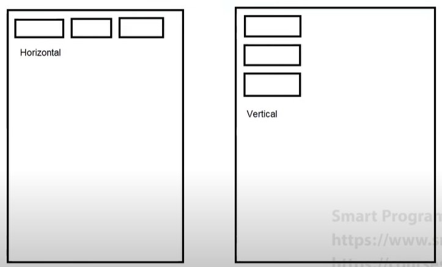

Practice this for understandig Linear layout:

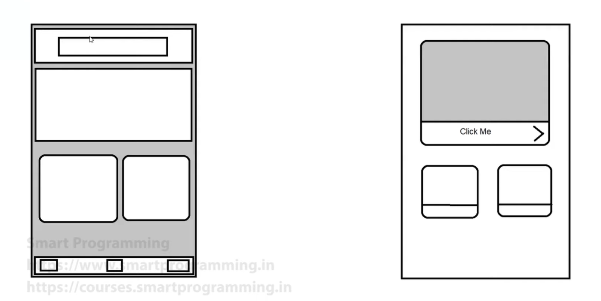

---
### 2. RelativeLayout:
- It arranges the widgets relative to the other layout and widgets.
- By default, it overlaps the widgets at the top-left corner.

Some important attributes for widgets are:
- `layout_centerInParent`
- `layout_toStartOf`
- `layout_toEndOf`
- `layout_centerVertical`
- `layout_centerHorizontal`
- `layout_alignParentBottom`

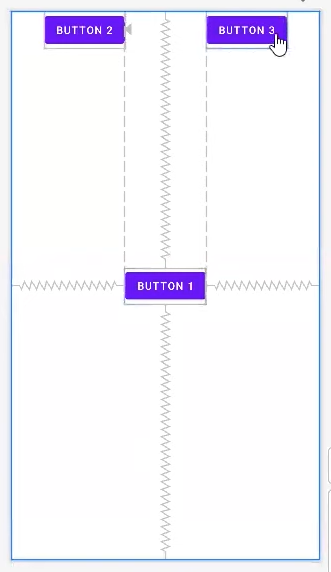

Practice this for understanding RelativeLayout:

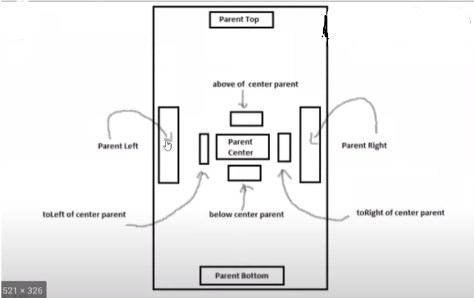

---
### ConstraintLayout:
- It is the latest layout introduced in 2016 and supports Android 2.3 or higher versions.
- It is a ViewGroup which allows us to create large and complex layouts with a flat view hierarchy.
- Its main advantage is that it reduces the nesting of View or ViewGroup which in turn improves the performance.
- It is very similar to RelativeLayout because it also defines relationships between multiple Views.

**Note:** It is compulsory to provide at least one vertical and one horizontal constraint.

### Terms in ConstraintLayout:
1. Constraint attributes
2. How to add and remove constraint
3. Bias (Horizontal and Vertical)
4. Chain (Horizontal and Vertical)

### Important Attributes:
- `layout_constraintStart_toStartOf`
- `layout_constraintEnd_toEndOf`
- `layout_constraintTop_toTopOf`
- `layout_constraintBottom_toBottomOf`
- `layout_constraintHorizontal_bias`
- `layout_constraintVertical_bias`
- `layout_constraintHorizontal_chainStyle`
- `layout_constraintVertical_chainStyle`

---

### Android Core Building Blocks:
- An Android component is simply a piece of code that has a well-defined lifecycle.
- For example, Activity, Receiver, Service, etc.
- The main Android core building blocks are:
  1. Activity
  2. AndroidManifest.xml
  3. Android Virtual Device (AVD)
  4. Views
  5. Intent
  6. Fragments
  7. Services
  8. Content Providers

### Activity:
- Activity is one of the most important core building blocks of the Android OS.
- An Activity is just a simple class which represents a single screen.
- Similar to how C, C++, and Java have an entry point, i.e., the `main()` method, Android also has an entry point, i.e., the `onCreate()` method, which is present in the Activity class.
- Every activity contains the layout, i.e., UI (`setContentView(R.layout.layout_name)`).

**How to create an Activity:**
1. Create a simple class and extend it with `AppCompatActivity`.
2. Override the `onCreate()` method (it is the method of the Activity lifecycle).
3. Call `setContentView(R.layout.layout_name)` method.

### Activity LifeCycle States:
1. Doesn't Exist / Destroy
2. Active / Foreground
3. Pause
4. Stopped / Background

### Methods of Activity LifeCycle:
1. `onCreate()` - called when the activity is launched for the first time.
2. `onStart()` - called when the activity is becoming visible to the user.
3. `onPause()` - called when the activity is not visible or the user is not able to interact.
4. `onResume()` - called when the user starts interacting with the activity.
5. `onRestart()` - called when the activity is stopped and then started again.
6. `onStop()` - called when the user is not able to interact with the activity.
7. `onDestroy()` - called when the activity is destroyed.

Understanding Working of Android LifeCycle By Image:

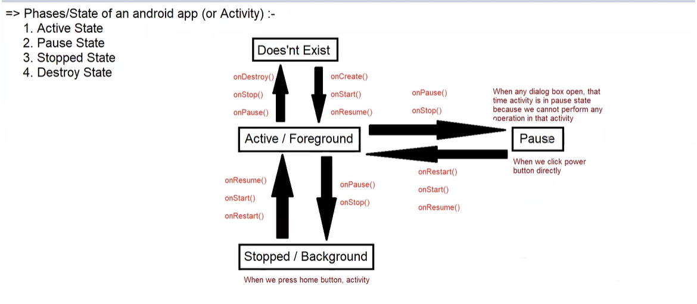 

---

### Intent:
- The dictionary meaning of intent is intention or purpose; thus, here intent is defined as the intention to do any action.
- Intent can also be described as a message to perform an action on the screen.

### Actions that can be performed by an Intent:
1. Launch another activity
2. Dial a phone call
3. Display the list of contacts
4. Display a web page
5. Start the service
6. Broadcast a message
   - etc.

- Intents are also used to communicate between application components and can provide connectivity between two apps.
- Programmatically, intents are objects used to pass information between activities within a single application or across multiple applications.

**For example:**
```java
Intent intent = new Intent(----);
startActivity(intent); // or startService(-);
```

### Types of Intent:
1. Implicit Intent
2. Explicit Intent

---

### Implicit Intent:
- Provides information to the available components provided by the system that is to be invoked.
- **Example:** Open a website in our application.

### Explicit Intent:
- Specifies the external component and provides the external class to be invoked.
- **Example:** Open another activity.
- **Note:** Whenever we open a new activity, the current activity is stored in the stack memory. When we press the back button, the previous activity opens, and it is removed from the stack memory.

### Uses of Intent:
- **Intent for an activity:**
  - We can open an activity by using `startActivity(intent);`.
  
- **Intent for services:**
  - Services execute in the background (e.g., downloading a file, playing music). We use the `startService(-)` method.

- **Intent for broadcast receivers:**
- Broadcast receivers handle messages, for example:
  - Displaying a message when the file is downloaded
  - Showing a warning message for low battery

---

## MenuBars
---
### Option MenuBar
### `XML`
```xml
<!-- Option MenuBar -->
<menu xmlns:android="http://schemas.android.com/apk/res/android">
    <item
        android:id="@+id/action_search" <!-- Unique ID for the search option -->
        android:icon="@drawable/ic_search" <!-- Icon for the search option -->
        android:title="Search" /> <!-- Title for the search option -->
    <!-- Additional menu items -->
</menu>
```

### Usages 
```java
@Override
public boolean onCreateOptionsMenu(Menu menu) {
    getMenuInflater().inflate(R.menu.option_menu, menu);
    return true;
}

@Override
public boolean onOptionsItemSelected(MenuItem item) {
    switch (item.getItemId()) {
        case R.id.action_search:
            // Handle search option click
            return true;
        // Add additional cases for other menu items if needed
        default:
            return super.onOptionsItemSelected(item);
    }
}

```
---

### PopUp MenuBar
### `XML`
```xml
<!-- PopUp MenuBar -->
<Button
    android:id="@+id/buttonPopupMenu" <!-- Unique ID for the button triggering the PopUp Menu -->
    android:layout_width="wrap_content" <!-- Width of the button wraps its content -->
    android:layout_height="wrap_content" <!-- Height of the button wraps its content -->
    android:text="Show Popup Menu" /> <!-- Text displayed on the button -->
```

### Usages 
```java
Button buttonPopupMenu = findViewById(R.id.buttonPopupMenu);
buttonPopupMenu.setOnClickListener(v -> {
    PopupMenu popupMenu = new PopupMenu(MainActivity.this, v);
    popupMenu.getMenuInflater().inflate(R.menu.popup_menu, popupMenu.getMenu());
    popupMenu.setOnMenuItemClickListener(item -> {
        switch (item.getItemId()) {
            // Handle popup menu item clicks
            default:
                return false;
        }
    });
    popupMenu.show();
});

```
---

### Context MenuBar
### `XML`
```xml
<!-- Context MenuBar -->
<TextView
    android:id="@+id/textViewContextMenu" <!-- Unique ID for the view triggering the Context Menu -->
    android:layout_width="wrap_content" <!-- Width of the TextView wraps its content -->
    android:layout_height="wrap_content" <!-- Height of the TextView wraps its content -->
    android:text="Long press to show context menu" <!-- Text displayed in the TextView -->
    android:longClickable="true" /> <!-- Enables long press -->
```
### Usages 
```java
TextView textViewContextMenu = findViewById(R.id.textViewContextMenu);
textViewContextMenu.setOnLongClickListener(v -> {
    registerForContextMenu(v);
    openContextMenu(v);
    return true;
});

@Override
public void onCreateContextMenu(ContextMenu menu, View v, ContextMenu.ContextMenuInfo menuInfo) {
    super.onCreateContextMenu(menu, v, menuInfo);
    getMenuInflater().inflate(R.menu.context_menu, menu);
}

@Override
public boolean onContextItemSelected(MenuItem item) {
    switch (item.getItemId()) {
        // Handle context menu item clicks
        default:
            return super.onContextItemSelected(item);
    }
}

```
---


## Topics of Animation Section
### Animation

- Animation using XML files
- Animation between activities
- Animation like battery
- Lottie Files
- Circular image
- Toasty
---

### Animation:
- It is the process by which objects (views in Android) can change their position or shape.

### Types of animations:
1. **Alpha Animation:** Can change the transparency of the view.
2. **Scale Animation:** Can change the size of the view on the x or y axis.
3. **Rotate Animation:** Can rotate the view on a pivot point to a certain degree.
4. **Translate Animation:** Can move the view on the x or y axis.

### Attributes for animations:
1. `android:duration="value"`
2. `android:repeatMode="restart"`
3. `android:repeatCount="infinite"`
4. `android:fillAfter="true"`


### Explanation

### Alpha Animation
```xml
<AlphaAnimation
    android:fromAlpha="1.0" <!-- Starting alpha value -->
    android:toAlpha="0.0" <!-- Ending alpha value -->
    android:duration="1000" <!-- Duration of the animation in milliseconds -->
    android:repeatCount="infinite" <!-- Number of times the animation should repeat (infinite for continuous) -->
    android:repeatMode="reverse" /> <!-- Determines how the animation should behave when it repeats (reverse to alternate direction) -->
```
### Usages 
```java
AlphaAnimation alphaAnimation = new AlphaAnimation(1.0f, 0.0f);
alphaAnimation.setDuration(1000);
view.startAnimation(alphaAnimation);
```
---

### Scale Animation
```xml
<ScaleAnimation
    android:fromXScale="1.0" <!-- Starting scale value on the x-axis -->
    android:toXScale="0.5" <!-- Ending scale value on the x-axis -->
    android:fromYScale="1.0" <!-- Starting scale value on the y-axis -->
    android:toYScale="0.5" <!-- Ending scale value on the y-axis -->
    android:pivotX="50%" <!-- X-axis pivot point of the view -->
    android:pivotY="50%" <!-- Y-axis pivot point of the view -->
    android:duration="1000" /> <!-- Duration of the animation in milliseconds -->
```

### Usages 
```java
ScaleAnimation scaleAnimation = new ScaleAnimation(
    1.0f, 0.5f,
    1.0f, 0.5f,
    Animation.RELATIVE_TO_SELF, 0.5f,
    Animation.RELATIVE_TO_SELF, 0.5f
);
scaleAnimation.setDuration(1000);
view.startAnimation(scaleAnimation);
```
---

### Rotate Animation
```xml
<RotateAnimation
    android:fromDegrees="0" <!-- Starting rotation degree -->
    android:toDegrees="360" <!-- Ending rotation degree -->
    android:pivotX="50%" <!-- X-axis pivot point of the view -->
    android:pivotY="50%" <!-- Y-axis pivot point of the view -->
    android:duration="1000" /> <!-- Duration of the animation in milliseconds -->
```

### Usages 
```java
RotateAnimation rotateAnimation = new RotateAnimation(
    0, 360,
    Animation.RELATIVE_TO_SELF, 0.5f,
    Animation.RELATIVE_TO_SELF, 0.5f
);
rotateAnimation.setDuration(1000);
view.startAnimation(rotateAnimation);
```
---


### Translate Animation
```xml
<TranslateAnimation
    android:fromXDelta="0" <!-- Starting translation distance on the x-axis -->
    android:toXDelta="100" <!-- Ending translation distance on the x-axis -->
    android:fromYDelta="0" <!-- Starting translation distance on the y-axis -->
    android:toYDelta="100" <!-- Ending translation distance on the y-axis -->
    android:duration="1000" /> <!-- Duration of the animation in milliseconds -->
```

### Usages 
```java
TranslateAnimation translateAnimation = new TranslateAnimation(
    Animation.ABSOLUTE, 0,
    Animation.ABSOLUTE, 100,
    Animation.ABSOLUTE, 0,
    Animation.ABSOLUTE, 100
);
translateAnimation.setDuration(1000);
view.startAnimation(translateAnimation);

```
---
- Note: 

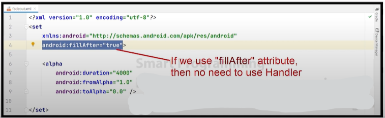
---


---


### What is a Fragment?

A Fragment is a modular section of an activity that represents a portion of user interface or behavior in an activity. It's often used to build flexible and reusable UI components. Fragments are lightweight compared to activities, offering better modularity and flexibility in designing complex user interfaces.

### Fragment Working

Fragments work within the context of an activity, allowing developers to divide the UI into smaller, reusable components. These components can be added, removed, or replaced dynamically within an activity's layout, providing a more flexible and interactive user experience.

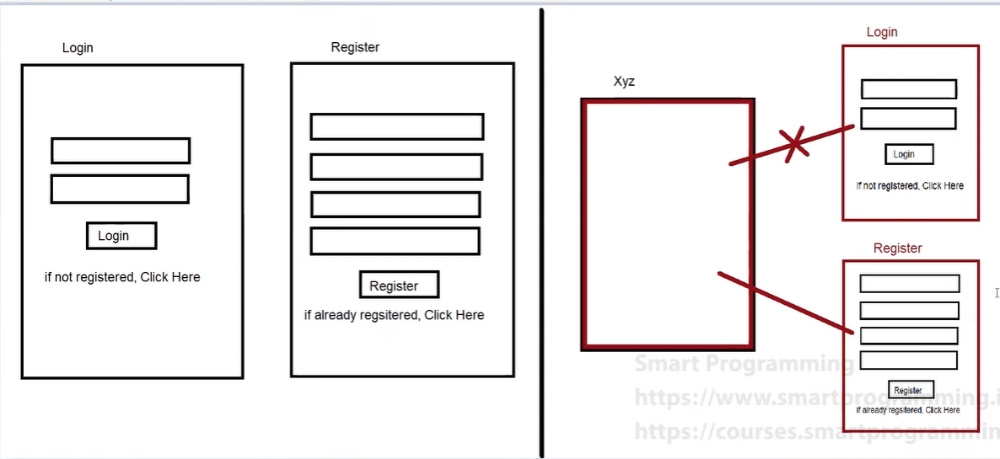

### Life Cycle of a Fragment

Similar to activities, fragments have their own lifecycle methods that are tied to the lifecycle of the hosting activity. Understanding the fragment lifecycle is crucial for managing UI updates, data loading, and resource allocation efficiently.

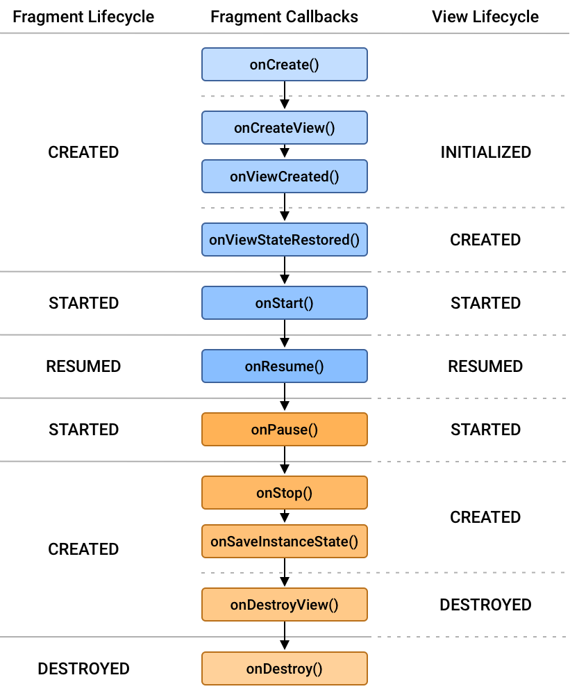

### How to Use Fragments

Integrating fragments into an activity involves a few key steps:

#### In the Main Java File:

```java
getSupportFragmentManager()
    .beginTransaction()
    .add(R.id.fragment_container, new MyFragment())
    .commit();
```

Here, `getSupportFragmentManager()` is used to obtain the FragmentManager for interacting with fragments associated with this activity. The `beginTransaction()` method begins a series of edit operations on the Fragments associated with this FragmentManager. `add()` is used to add a fragment to the activity state, and `commit()` is used to apply the changes.

#### In the Fragment File:

```java
getParentFragmentManager()
    .beginTransaction()
    .add(R.id.fragment_container, new MyFragment())
    .commit();
```

Similarly, `getParentFragmentManager()` is used to obtain the FragmentManager associated with the parent activity. The process for adding fragments remains the same as in the main Java file.


---

### ViewPager2 vs. ViewPager

ViewPager2 is the updated version of ViewPager, providing improved performance and additional features. It offers better support for handling changes to the underlying data set, including adding and removing items dynamically.

For the adapter:
- If you're using ViewPager2, extend `FragmentStateAdapter`.
- If you're using the old ViewPager, extend `FragmentPagerAdapter`.

Since we're using ViewPager2, we'll extend `FragmentStateAdapter`.

### Adapter: FragmentStateAdapter

In the adapter's `createFragment` method, we'll switch between all the fragments' layouts. This method is responsible for creating the fragment associated with each position in the ViewPager2.

```java
public class MyFragmentStateAdapter extends FragmentStateAdapter {

    public MyFragmentStateAdapter(FragmentActivity fragmentActivity) {
        super(fragmentActivity);
    }

    @NonNull
    @Override
    public Fragment createFragment(int position) {
        switch (position) {
            case 0:
                return new FragmentOne();
            case 1:
                return new FragmentTwo();
            case 2:
                return new FragmentThree();
            // Add more cases for additional fragments
            default:
                return new DefaultFragment();
        }
    }

    @Override
    public int getItemCount() {
        return 3; // Number of fragments
    }
}
```

### In the main Java file:
```java
ViewPager2 viewPager2 = findViewById(R.id.viewPager2);
MyFragmentStateAdapter adapter = new MyFragmentStateAdapter(this);
viewPager2.setAdapter(adapter);
```

#### Ensure that your layout XML file contains a ViewPager2 element with the appropriate ID:

```xml
<androidx.viewpager2.widget.ViewPager2
    android:id="@+id/viewPager2"
    android:layout_width="match_parent"
    android:layout_height="match_parent" />
```

Here, we create an instance of `MyFragmentStateAdapter` and set it as the adapter for our ViewPager2 (`viewPager2`). Ensure that you've defined the ViewPager2 in your layout XML with the appropriate ID (`viewPager2` in this case).


---

## Tab Layout with Fragments

### In the Main XML Layout File:

```xml
<androidx.appcompat.widget.Toolbar
    android:id="@+id/toolbar"
    android:layout_width="match_parent"
    android:layout_height="?attr/actionBarSize"
    android:background="?attr/colorPrimary"
    app:title="Tab Layout Example" />

<com.google.android.material.tabs.TabLayout
    android:id="@+id/tabLayout"
    android:layout_width="match_parent"
    android:layout_height="wrap_content"
    android:background="?attr/colorPrimary"
    android:theme="@style/ThemeOverlay.AppCompat.Dark.ActionBar"
    app:tabGravity="fill"
    app:tabIndicatorColor="@color/white"
    app:tabMode="fixed"
    app:tabSelectedTextColor="@color/white"
    app:tabTextColor="@color/white" />

<FrameLayout
    android:id="@+id/frameLayout"
    android:layout_width="match_parent"
    android:layout_height="match_parent" />
```

### In the Main Java File:

```java
TabLayout tabLayout = findViewById(R.id.tabLayout);
FrameLayout frameLayout = findViewById(R.id.frameLayout);

// Add tabs to the TabLayout
TabLayout.Tab tab1 = tabLayout.newTab().setText("Tab 1");
TabLayout.Tab tab2 = tabLayout.newTab().setText("Tab 2");
TabLayout.Tab tab3 = tabLayout.newTab().setText("Tab 3");

tabLayout.addTab(tab1);
tabLayout.addTab(tab2);
tabLayout.addTab(tab3);

// Set up a TabLayout.OnTabSelectedListener to switch fragments
tabLayout.addOnTabSelectedListener(new TabLayout.OnTabSelectedListener() {
    @Override
    public void onTabSelected(TabLayout.Tab tab) {
        switch (tab.getPosition()) {
            case 0:
                getSupportFragmentManager().beginTransaction().replace(R.id.frameLayout, new Fragment1()).commit();
                break;
            case 1:
                getSupportFragmentManager().beginTransaction().replace(R.id.frameLayout, new Fragment2()).commit();
                break;
            case 2:
                getSupportFragmentManager().beginTransaction().replace(R.id.frameLayout, new Fragment3()).commit();
                break;
            // Add more cases for additional tabs
        }
    }

    @Override
    public void onTabUnselected(TabLayout.Tab tab) {}

    @Override
    public void onTabReselected(TabLayout.Tab tab) {}
});
```

### Notes:

- Ensure you have Fragment1, Fragment2, Fragment3 (or any other fragments you want to use) defined.
- Replace `R.id.frameLayout` with the ID of the FrameLayout where you want to display the fragments.
- You can customize the appearance of the tabs and the behavior of the TabLayout by adjusting attributes and listeners as needed.

---

### Permissions

#### Declared Permissions in AndroidManifest.xml File
Permissions in AndroidManifest.xml file are categorized into two types:

##### 1. Normal Permissions:
- Only declared in AndroidManifest.xml file.
- Examples include INTERNET, BLUETOOTH, FINGER_PRINT, etc.

##### 2. Dangerous Permissions:
- Declared in AndroidManifest.xml file.
- Requires additional code for runtime permissions.
- Examples include CONTACTS, SMS, CALL, LOCATION, etc.

[Here](https://stackoverflow.com/questions/36936914/list-of-android-permissions-normal-permissions-and-dangerous-permissions-in-api) is a list of normal and dangerous permissions.


# Making a Phone Call from an Android App

## Dialing a Number
To open the dialer with a phone number:

```java
Intent intent = new Intent(Intent.ACTION_DIAL);
intent.setData(Uri.parse("tel:" + Number));
startActivity(intent);
```

## Steps to Call Directly from the App

### 1. Add Required Permission in the Manifest File
First, add the required permission in your `AndroidManifest.xml` file:
```xml
<uses-permission android:name="android.permission.CALL_PHONE"/>
```

### 2. Check and Request Permission
Then, check if the permission is granted and request it if necessary:

```java
final int REQUEST_CALL_CODE = 1;

if (ContextCompat.checkSelfPermission(this, Manifest.permission.CALL_PHONE) == PackageManager.PERMISSION_GRANTED) {
   call();
} else {
    ActivityCompat.requestPermissions(this, new String[]{Manifest.permission.CALL_PHONE}, REQUEST_CALL_CODE);
}

void call(){
    Intent intent = new Intent(Intent.ACTION_CALL);
    intent.setData(Uri.parse("tel:" + Number));
    startActivity(intent);
}
```

### Notes:
- Replace `Number` with the actual phone number you want to call.
- Ensure you handle the permission request result in your activity by overriding `onRequestPermissionsResult`.

```java
@Override
public void onRequestPermissionsResult(int requestCode, @NonNull String[] permissions, @NonNull int[] grantResults) {
    if (requestCode == REQUEST_CALL_CODE) {
        if (grantResults.length > 0 && grantResults[0] == PackageManager.PERMISSION_GRANTED) {
           call();
        } else {
            // Permission denied, show a message to the user
        }
    }
}
```
- Make sure to handle runtime permissions properly to ensure a smooth user experience.


# Sending an SMS from an Android App

## SMS Sending Function
A function to send an SMS:

```java
void smsCode() {
    String msg = getFromId(); // Retrieve the message from the corresponding ID
    String phoneNum = getFromId(); // Retrieve the phone number from the corresponding ID
    SmsManager manager = SmsManager.getDefault();
    manager.sendTextMessage(phoneNum, null, msg, null, null);
    Toast.makeText(this, "SMS was sent", Toast.LENGTH_SHORT).show();
}
```

## Check and Request SMS Permission
A function to send an SMS after checking for the required permission:

```java
void sendSMS(View view) {
    if (ContextCompat.checkSelfPermission(this, Manifest.permission.SEND_SMS) == PackageManager.PERMISSION_GRANTED) {
        smsCode();
    } else {
        ActivityCompat.requestPermissions(this, new String[]{Manifest.permission.SEND_SMS}, REQUEST_SMS_CODE);
    }
}
```

### Notes:
- Replace `getFromId()` with the appropriate method to retrieve the message and phone number from your UI elements.
- Ensure you handle the permission request result in your activity by overriding `onRequestPermissionsResult`.

```java
final int REQUEST_SMS_CODE = 2;

@Override
public void onRequestPermissionsResult(int requestCode, @NonNull String[] permissions, @NonNull int[] grantResults) {
    if (requestCode == REQUEST_SMS_CODE) {
        if (grantResults.length > 0 && grantResults[0] == PackageManager.PERMISSION_GRANTED) {
            // Permission granted, send the SMS
            smsCode();
        } else {
            // Permission denied, show a message to the user
            Toast.makeText(this, "Permission denied to send SMS", Toast.LENGTH_SHORT).show();
        }
    }
}
```

- Make sure to handle runtime permissions properly to ensure a smooth user experience.
- Add the following permission in your `AndroidManifest.xml` file:

```xml
<uses-permission android:name="android.permission.SEND_SMS"/>
```

Here is your provided notes formatted into proper Markdown:

```markdown
# Accessing Gallery and Camera in an Android App

## Opening Gallery to Select an Image
To open the gallery and select an image:

```java
Intent intent = new Intent();
intent.setType("image/*");  // For opening the gallery
intent.setAction(Intent.ACTION_GET_CONTENT);

startActivityForResult(Intent.createChooser(intent, "Select Picture"), REQUEST_GALLERY_CODE);
```

### Handling the Result
Override the `onActivityResult` method to handle the selected image:

```java
@Override
protected void onActivityResult(int requestCode, int resultCode, Intent data) {
    super.onActivityResult(requestCode, resultCode, data);
    if (requestCode == REQUEST_GALLERY_CODE && resultCode == RESULT_OK) {
        Uri uri = data.getData();
        if (uri != null) {
            imageView.setImageURI(uri);
        }
    }
}
```

### Notes:
- Replace `REQUEST_GALLERY_CODE` with your actual request code for the gallery.
- Replace `imageView` with the actual ID of your `ImageView`.

## Example Code with Proper Structure

### Declaring Constants
Declare your request codes at the beginning of your activity:

```java
private static final int REQUEST_GALLERY_CODE = 1;
```


### Opening Gallery
To open the gallery and select an image:

```java
void openGallery() {
    Intent intent = new Intent();
    intent.setType("image/*");
    intent.setAction(Intent.ACTION_GET_CONTENT);
    startActivityForResult(Intent.createChooser(intent, "Select Picture"), REQUEST_GALLERY_CODE);
}
```

### Handling the Result
Override the `onActivityResult` method to handle the selected image:

```java
@Override
protected void onActivityResult(int requestCode, int resultCode, Intent data) {
    super.onActivityResult(requestCode, resultCode, data);
    if (requestCode == REQUEST_GALLERY_CODE && resultCode == RESULT_OK) {
        Uri uri = data.getData();
        if (uri != null) {
            ImageView imageView = findViewById(R.id.imageView); // Replace with your ImageView ID
            imageView.setImageURI(uri);
        }
    }
}
```

### Notes:
- Ensure your `ImageView` has the correct ID.
- Replace `"imageView"` with the actual ID of your `ImageView` in your layout file.


---

## Shared Preferences

1. **Definition**: A way to store or retrieve a small amount of data.
2. **Data Types**: Can store only primitive types (int, float, boolean, and String).
3. **Storage Format**: Data is stored in the form of key-value pairs.

### Uses of Shared Preferences
- User settings
- Keeping user logged into the application
- Session management, etc.

### Characteristics
- Application-specific data
- Can delete data by:
  - Uninstalling the application
  - Manual code (e.g., logout)
  - Mobile settings
- Provides an API (classes) to read, write, or manage its data.

### Initialization
```java
SharedPreferences pref = getApplicationContext().getSharedPreferences("pref-file-name", 0);
SharedPreferences.Editor editor = pref.edit();
```

### Storing Data
```java
editor.putString(key, value);
editor.commit();
```

### Deleting All Data
```java
editor.clear();
editor.commit();
```

### Deleting Selected Data
```java
editor.remove(key);
editor.commit();
```

### Retrieving Data
```java
String value = pref.getString(key, null);
```

### Example: SessionManager Class
```java
import android.content.Context;
import android.content.SharedPreferences;

public class SessionManager {
    
    private Context context;
    private SharedPreferences sp;
    private SharedPreferences.Editor editor;

    private static final String PREF_FILE_NAME = "shopping";
    private static final int PRIVATE_MODE = 0;

    private static final String KEY_NAME = "key_session_name";
    private static final String KEY_EMAIL = "key_session_email";
    private static final String KEY_PHNO = "key_session_phno";
    private static final String KEY_IF_LOGGED_IN = "key_logged_in";

    public SessionManager(Context context) {
        this.context = context;
        sp = context.getSharedPreferences(PREF_FILE_NAME, PRIVATE_MODE);
        editor = sp.edit();
    }

    public boolean checkSession() {
        return sp.contains(KEY_IF_LOGGED_IN);
    }

    public String getSessionDetails(String key) {
        return sp.getString(key, null);
    }

    public void createSession(String name, String email, String phno) {
        editor.putString(KEY_NAME, name);
        editor.putString(KEY_EMAIL, email);
        editor.putString(KEY_PHNO, phno);
        editor.putBoolean(KEY_IF_LOGGED_IN, true);
        editor.commit();
    }
}
```

---

## SQLite Database

- **Definition**: An open-source relational database.
- **Availability**: Inbuilt in every Android smartphone device.
- **API**: Android provides an API to interact with SQLite Database.

### Components

1. **SQLiteOpenHelper**
   - Used to create the database and manage versions.
   - Methods:
     - `onCreate()`
     - `onUpgrade()`

2. **SQLiteDatabase**
   - Methods:
     - `insert()`
     - `delete()`
     - `update()`
     - `query()`
     - `execSQL(query)`

3. **Cursor**
   - Methods:
     - `moveToFirst()`
     - `moveToNext()`

4. **User Defined Helper Class**
   - Extends `SQLiteOpenHelper` class.
   - Methods:
     - `getWritableDatabase()`
     - `getReadableDatabase()`

### CRUD Operations

- **C** - Create
- **R** - Retrieve
- **U** - Update
- **D** - Delete

### Example: DbHelper Class

```java
import android.content.ContentValues;
import android.content.Context;
import android.database.Cursor;
import android.database.sqlite.SQLiteDatabase;
import android.database.sqlite.SQLiteOpenHelper;
import androidx.annotation.Nullable;

public class DbHelper extends SQLiteOpenHelper {

    private static final String DATABASE_NAME = "demo_db";
    private static final int DATABASE_VERSION = 1;
    private static final String TABLE_NAME = "register";
    private static final String COLUMN_ID = "id";
    private static final String COLUMN_NAME = "name";
    private static final String COLUMN_EMAIL = "email";
    private static final String COLUMN_PASSWORD = "password";

    public DbHelper(@Nullable Context context) {
        super(context, DATABASE_NAME, null, DATABASE_VERSION);
    }

    @Override
    public void onCreate(SQLiteDatabase db) {
        String CREATE_TABLE_QUERY = "CREATE TABLE " + TABLE_NAME + "(" +
                                    COLUMN_ID + " INTEGER PRIMARY KEY AUTOINCREMENT, " +
                                    COLUMN_NAME + " TEXT, " +
                                    COLUMN_EMAIL + " TEXT, " +
                                    COLUMN_PASSWORD + " TEXT)";
        db.execSQL(CREATE_TABLE_QUERY);
    }

    @Override
    public void onUpgrade(SQLiteDatabase db, int oldVersion, int newVersion) {
        db.execSQL("DROP TABLE IF EXISTS " + TABLE_NAME);
        onCreate(db);
    }

    // Create
    public void registerUserHelper(String name, String email, String password) {
        SQLiteDatabase sqLiteDatabase = this.getWritableDatabase();
        ContentValues contentValues = new ContentValues();
        contentValues.put(COLUMN_NAME, name);
        contentValues.put(COLUMN_EMAIL, email);
        contentValues.put(COLUMN_PASSWORD, password);
        sqLiteDatabase.insert(TABLE_NAME, null, contentValues);
    }

    // Retrieve
    public ArrayList<UserModal> getLoggedinUserDetails(String email) {
        ArrayList<UserModal> al = new ArrayList<>();
        SQLiteDatabase sqLiteDatabase = this.getReadableDatabase();
        String query = "SELECT * FROM register WHERE email=?";
        
        // Using try-with-resources to ensure resources are closed properly
        try (Cursor cursor = sqLiteDatabase.rawQuery(query, null)) {
            if (cursor.moveToFirst()) {
                do {
                    String name = cursor.getString(1);
                    String emailFromDB = cursor.getString(2);
                    String gender = cursor.getString(3);
                    
                    UserModal user = new UserModal();
                    user.setName(name);
                    user.setEmail(emailFromDB);
                    user.setGender(gender);
                    
                    al.add(user);
                } while (cursor.moveToNext());
            }
        } catch (Exception e) {
            e.printStackTrace();
        }

        return al;
    }


    // Update
    public int updateUserEmail(String oldEmail, String newEmail) {
        SQLiteDatabase sqLiteDatabase = this.getWritableDatabase();
        ContentValues contentValues = new ContentValues();
        contentValues.put(COLUMN_EMAIL, newEmail);
        return sqLiteDatabase.update(TABLE_NAME, contentValues, COLUMN_EMAIL + "=?", new String[]{oldEmail});
    }

    // Delete
    public int deleteUserByEmail(String email) {
        SQLiteDatabase sqLiteDatabase = this.getWritableDatabase();
        return sqLiteDatabase.delete(TABLE_NAME, COLUMN_EMAIL + "=?", new String[]{email});
    }
}
```

### Usage

- **Initialize Database Helper**:
  ```java
  DbHelper dbHelper = new DbHelper(context);
  ```

- **Create**:
  ```java
  dbHelper.registerUserHelper("John Doe", "john@example.com", "password123");
  ```

- **Update**:
  ```java
  int rowsAffected = dbHelper.updateUserEmail("john@example.com", "john.doe@example.com");
  ```

- **Delete**:
  ```java
  int rowsAffected = dbHelper.deleteUserByEmail("john.doe@example.com");
  ```

---


### Cursor
- Cursor is the Interface which represents a 2 dimensional table of any database. When you try to retrieve some data using SELECT statement, then the database will first create a CURSOR object and return its reference to you.

In simple words, Cursor is a Interface whice returns collection of your query data. moveToFirst() is used to point the cursor position from where you want to get data from your cursor. There are methods moveToLast(), moveToNext(), moveToPrevious(), moveToPosition(position) by which you can iterate through your cursor by desired way.

For example, you have data in your Cursor

`
Lalit
Rithesh
Paresh
Chandra
`

- moveToFirst() - If you use cursor.moveToFirst() then in this case it will point Lalit, as it is the first data in your cursor. To get the next data from cursor you can use moveToNext().

- moveToLast() - This will point Chandra as the current data in your cursor. To get the previous data from cursor you can use moveToPrevious()


---


### How Android Communicates with Java API and MySQL

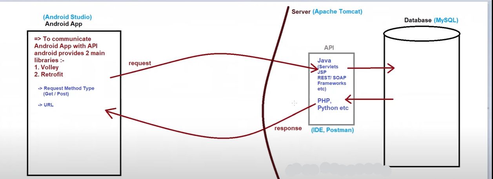

### Softwares Used for Connecting Android with MySQL
1. **Android Studio**: Used to develop the Android app.
2. **Apache Tomcat (Server)**: Used to deploy the API.
3. **MySQL (Database)**: Used to store the data.
4. **IDE (NetBeans, Eclipse, or any other IDE)**: Used to create the API.
5. **Postman**: Used to check if our API is working properly or not, and to check the response of our API.
6. **XAMPP**: XAMPP stands for:
   - X - Cross platform
   - A - Apache
   - M - MySQL
   - P - PHP
   - P - Perl

### If We Develop API in Java (Servlets) Then We Have to Use the Below Softwares:
1. **IDE (NetBeans)**: NetBeans will contain Apache Tomcat Server as well.
2. **Postman**
3. **MySQL**

### If We Develop API in PHP Then We Have to Use the Below Softwares:
1. **IDE**
2. **XAMPP**

### Working of app and api

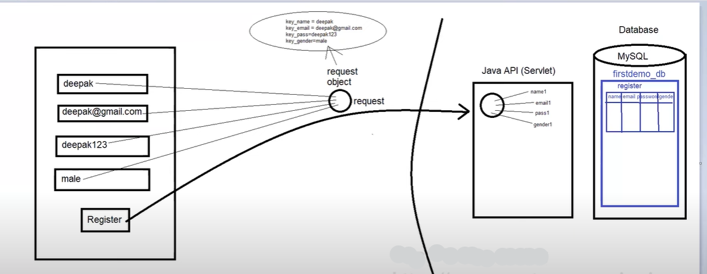

### How to Connect Mobile to Laptop and Run the API on Mobile

1. Connect the laptop and mobile to the same Wi-Fi device OR connect the mobile hotspot to the laptop.
2. Open CMD and run as administrator.
3. Type the command `ipconfig` and copy the IPv4 Address. Paste it in the API URL/link.
4. Convert `http://localhost:8084/ApiDemo1/Register` to `http://<IPv4 Address>:8084/ApiDemo1/Register`.
   - Example: `http://localhost:8084/ApiDemo1/Register` becomes `http://192.168.1.3:8084/ApiDemo1/Register`.
5. Run this link in the mobile browser.


---

### Volley Library

- **Volley** is an HTTP library developed by Google and was introduced first in 2013.
- Its main use is to transmit data over the network.
- It is available through the AOSP (Android Open Source Project) repository, so we need to provide its implementation in our project.

#### Advantages of Volley

1. Provides efficient network management.
2. Easier and faster request management.
3. Caching.

#### Classes in Volley Library

1. **RequestQueue**
2. **Request**

#### Types of Requests

1. **StringRequest**
2. **JsonObjectRequest**
3. **JsonArrayRequest**
4. **ImageRequest**


### Note:
- Their may come issue about your Android app is trying to connect to a local server using HTTP (non-secure connection), but Android versions 9 (API level 28) and above block non-secure HTTP connections by default for security reasons.

### To fix this issue we have to do this:

1. **Create the Network Security Configuration file**:

   - Create a file `res/xml/network_security_config.xml`.
   - Add the following content to the file:

   ```xml
   <?xml version="1.0" encoding="utf-8"?>
   <network-security-config>
       <domain-config cleartextTrafficPermitted="true">
           <domain includeSubdomains="true">192.168.1.5</domain>
       </domain-config>
   </network-security-config>
   ```

2. **Modify the AndroidManifest.xml**:

   - Add the `android:networkSecurityConfig` attribute to the `<application>` tag in your `AndroidManifest.xml`.

   ```xml
   <application
       android:networkSecurityConfig="@xml/network_security_config"
       ... >
       ...
   </application>
   ```


---

### Creating PHP API

The V8 engine executes JavaScript in web browsers (e.g., Chrome) and Node.js, while the Zend Engine runs PHP on web servers via integrations like Apache with mod_php or Nginx with PHP-FPM.

#### PHP Basics

- **PHP** is a server-side scripting language.

#### How to Create a PHP File

1. Start and end with PHP tag: `<?php ----- ?>`
2. Save the file with `.php` extension.

### Error Fixing for XAMPP

1. Run the command `netstat -ano | findstr :3306` and note the PID number.
2. Go to Task Manager.
3. Select the "Details" tab and search for that PID number there. End the process.

### Error Fixing for MySQL

1. Open the configurator of MySQL and configure it again.
2. Open the terminal of MySQL and it should be fixed.

### How to Create a Simple PHP API

1. Create a PHP file with some echo code:
   ```php
   <?php
   echo "Hello, World!";
   ?>
   ```
2. Open the XAMPP folder in the C drive.
3. Navigate to the `htdocs` folder and paste the PHP file there.
4. Open XAMPP and in the Apache server, select the "Admin" option.
5. Modify the URL by adding `/your_php_file_name.php` at the end.
   - Example: `http://localhost/your_php_file_name.php`
6. Done.

### Example of PHP API

#### Example PHP File (hello.php)
```php
<?php
header("Content-Type: application/json");

$response = array(
    "status" => "success",
    "message" => "Hello, World!"
);

echo json_encode($response);
?>
```

#### Steps to Run the PHP File

1. Save the above PHP code in a file named `hello.php`.
2. Place the `hello.php` file in the `htdocs` folder in the XAMPP directory.
3. Start Apache server from the XAMPP control panel.
4. Open a web browser and navigate to `http://localhost/hello.php`.
5. You should see a JSON response with a message: `{"status":"success","message":"Hello, World!"}`.


### Connecting to MySQL

```php
<?php
$host = "localhost";
$username = "root";
$password = "";
$db = "firstphpdb";

$con = @mysqli_connect($host, $username, $password, $db) or die(mysqli_error($con));

if ($con->connect_error) {
    echo "Failed";
} else {
    echo "Success";
}
?>
```

### Inserting Data into the Database

```php
<?php
//----------database connection starts-----------------------
$host = "localhost";
$username = "root";
$password = "";
$db = "firstphpdb";

$con = @mysqli_connect($host, $username, $password, $db) or die(mysqli_error($con));
//----------database connection ends-------------------------

$name = "deepak";
$email = "deepak@gail.com";
$pass = "deepak123";
$gender = "male";

$my_query = "INSERT INTO register (name, email, password, gender) VALUES ('$name', '$email', '$pass', '$gender')";

$result = mysqli_query($con, $my_query);

if ($result) {
    echo "Success";
} else {
    echo "Fail";
}
?>
```

### Preparing for Android Application to Send Data to PHP

```php
<?php
//----------database connection starts-----------------------
$host = "localhost";
$username = "root";
$password = "";
$db = "firstphpdb";

$con = @mysqli_connect($host, $username, $password, $db) or die(mysqli_error($con));
//----------database connection ends-------------------------

$name = $_POST["key_name"];
$email = $_POST["key_email"];
$pass = $_POST["key_pass"];
$gender = $_POST["key_gender"];

$my_query = "INSERT INTO register (name, email, password, gender) VALUES ('$name', '$email', '$pass', '$gender')";

$result = mysqli_query($con, $my_query);

if ($result) {
    echo "success";
} else {
    echo "fail";
}
?>
```


---

## RecyclerView

RecyclerView is similar to ListView but differs in that it only stores the data currently visible on the screen, which helps to:
- Reduce memory usage

### Note
- Use RecyclerView for better performance and more features when displaying large or complex lists.
- Choose ListView for simple, quick lists in older apps.

### Using RecyclerView
To use RecyclerView, you need to add the necessary dependency to your project.

### Steps to Implement RecyclerView

1. **Design a Single Row Layout**: Create a layout file for a single row/item in the list.

2. **Create an Adapter Class**: The adapter class will include a constructor and two key methods along with a ViewHolder class:
    - **Constructor**: Used to take in data.
    - **onCreateViewHolder()**: Inflate the XML layout for the single row.
    - **onBindViewHolder()**: Bind data to the views.
    - **ViewHolder Class**: Holds the views (single row design). This class will be passed as a generic type to the adapter class, helping to get the object in `onCreateViewHolder()` and `onBindViewHolder()` methods.

### Example Structure of RecyclerView Adapter

```java
public class MyAdapter extends RecyclerView.Adapter<MyAdapter.MyViewHolder> {
    private List<MyDataModel> dataList;

    // Constructor
    public MyAdapter(List<MyDataModel> dataList) {
        this.dataList = dataList;
    }

    // ViewHolder is a static inner class of RecyclerView
    public class MyViewHolder extends RecyclerView.ViewHolder {
        // Define your view elements here

        public MyViewHolder(View itemView) {
            super(itemView);
            // Initialize your view elements here
        }
    }

    @Override
    public MyViewHolder onCreateViewHolder(ViewGroup parent, int viewType) {
        // Inflate the single row layout
        View itemView = LayoutInflater.from(parent.getContext())
                .inflate(R.layout.single_row_layout, parent, false);
        return new MyViewHolder(itemView);
    }

    @Override
    public void onBindViewHolder(MyViewHolder holder, int position) {
        // Bind data to the views
        MyDataModel dataModel = dataList.get(position);
        // Set data to your views
    }

    @Override
    public int getItemCount() {
        return dataList.size();
    }
}
```

### Diagram
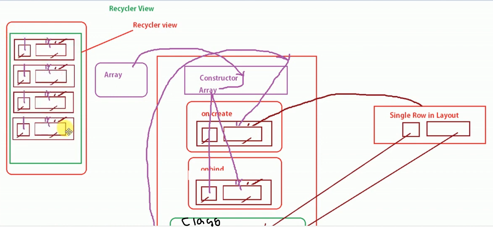

### Adding RecyclerView Dependency
To use RecyclerView, you need to add the following dependency in your `build.gradle` file:
```gradle
dependencies {
    implementation 'androidx.recyclerview:recyclerview:1.2.1'
}
```


### Some Additional Notes:

- **Setting Layout Manager**: 
  RecyclerView requires a layout manager to manage the arrangement of its items. In your Java class file, you need to set the layout manager. Commonly used layout managers include LinearLayoutManager, GridLayoutManager, and StaggeredGridLayoutManager.

  Example of setting LinearLayoutManager:
  ```java
  RecyclerView recyclerView = findViewById(R.id.recyclerView);
  recyclerView.setLayoutManager(new LinearLayoutManager(this));
  ```

- **ViewHolder Class**: 
  When creating the ViewHolder class, it assumes that its object has been created, and the view of the designed layout is passed to it from the onCreateViewHolder method. This ViewHolder class uses this passed view object to access the widgets inside the XML layout. Therefore, initialize and declare the widgets inside the ViewHolder class.

  Example ViewHolder class:
  ```java
  public static class MyViewHolder extends RecyclerView.ViewHolder {
      TextView titleTextView;
      ImageView iconImageView;
  
      public MyViewHolder(View itemView) {
          super(itemView);
          // Initialize your view elements here
          titleTextView = itemView.findViewById(R.id.titleTextView);
          iconImageView = itemView.findViewById(R.id.iconImageView);
      }
  }
  ```

- **onCreateViewHolder and onBindViewHolder**: 
  - **onCreateViewHolder**: Inflates the XML layout for a single row/item in the list and returns a ViewHolder object.
  - **onBindViewHolder**: Binds data to the views within the ViewHolder.

  Example:
  ```java
  @Override
  public MyViewHolder onCreateViewHolder(ViewGroup parent, int viewType) {
      // Inflate the single row layout
      View itemView = LayoutInflater.from(parent.getContext())
              .inflate(R.layout.single_row_layout, parent, false);
      return new MyViewHolder(itemView);
  }
  
  @Override
  public void onBindViewHolder(MyViewHolder holder, int position) {
      // Bind data to the views
      MyDataModel dataModel = dataList.get(position);
      holder.titleTextView.setText(dataModel.getTitle());
      holder.iconImageView.setImageResource(dataModel.getIconResource());
  }
  ```

---

## RecyclerView with CardView

Learn how to professionally implement a RecyclerView with CardView, using separate model and view holder classes.

### Dependencies

- Add RecyclerView and CardView dependencies to your `build.gradle` file.

```gradle
dependencies {
    implementation 'androidx.recyclerview:recyclerview:1.2.1'
    implementation 'androidx.cardview:cardview:1.0.0'
}
```

### Steps to Implement RecyclerView with CardView

1. **Design the Single Row Layout**
   - Create an XML layout file for a single row, incorporating CardView to provide a polished look.

2. **Create the ViewHolder Class**
   - The ViewHolder class references the widgets in the single row design XML file. 
   - Initialize and declare the widgets inside the ViewHolder class.

3. **Create the Model Class**
   - The model class is created based on the number of widgets in the single row design XML file.
   - Include getter and setter methods for these widgets.

4. **Create and Populate an ArrayList**
   - Create an ArrayList and store all the widget objects from the model class in it.

### Visual Representation

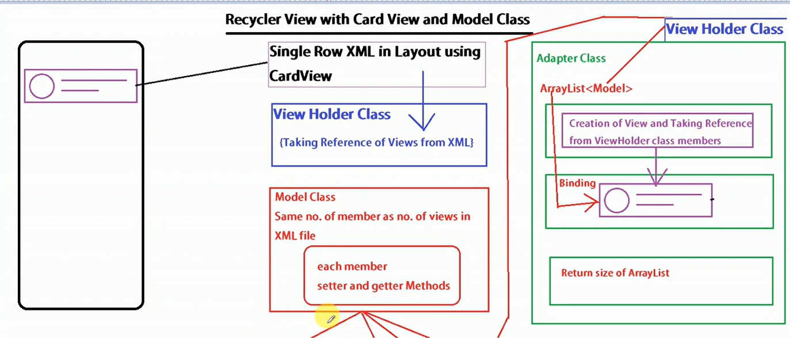


### Detailed Steps

1. **Single Row Layout Design**
   - Define an XML layout for a single row, typically including a CardView that contains the various widgets (e.g., TextView, ImageView).

2. **ViewHolder Class**
   - In this class, reference the XML layout widgets by their IDs.
   - This class is responsible for holding and recycling the views as they scroll off the screen.

3. **Model Class**
   - Define a class that represents the data structure for each row in the RecyclerView.
   - Include private member variables for each widget in the row layout.
   - Implement getter and setter methods for these variables.

4. **ArrayList Initialization**
   - Instantiate an ArrayList of the model class.
   - Populate this ArrayList with data objects, representing the content to be displayed in each row of the RecyclerView.

---


